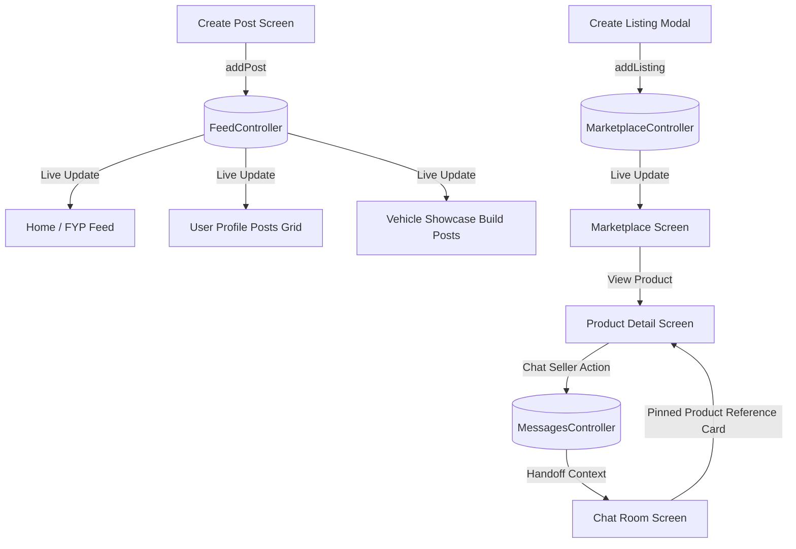

# AUTOVERSE — TECHNICAL ARCHITECTURE & DATA FLOW
**Document Version:** 1.0.0  
**Target:** Software Engineering Architecture Review  

---

## 1. Architectural Paradigm Overview

AutoVerse implements a **Reactive, Feature-First Clean Architecture** built entirely on native Flutter framework primitives. The architecture prioritizes:
- **Predictable unidirectional data flow.**
- **Strong state encapsulation.**
- **Zero third-party state library dependencies** (eliminating vendor lock-in and dependency incompatibilities).
- **Sub-millisecond reactive UI updates** using Flutter's native `ListenableBuilder` and `ChangeNotifier`.

```
┌─────────────────────────────────────────────────────────────┐
│                     PRESENTATION LAYER                      │
│   Screens  •  Extracted Modals  •  Feature Widgets  • Theme │
└──────────────────────────────▲──────────────────────────────┘
                               │ Reads / Subscribes via ListenableBuilder
                               ▼ Dispatches User Intent (Methods)
┌─────────────────────────────────────────────────────────────┐
│                   STATE / CONTROLLER LAYER                  │
│    FeedController • MarketplaceController • MessagesController│
│                 (extends ChangeNotifier)                    │
└──────────────────────────────▲──────────────────────────────┘
                               │ Maps to / from
                               ▼
┌─────────────────────────────────────────────────────────────┐
│                      DATA / MODEL LAYER                     │
│   Immutable Models (Post, Vehicle, Product, Conversation)   │
│                 In-Memory Seed Repositories                 │
└─────────────────────────────────────────────────────────────┘
```

---

## 2. Core Architectural Layers

### 2.1 Data & Entity Layer (`lib/data/`)
The foundational data layer defines domain entities using immutable Dart classes with copy and formatting utilities:
- `PostModel`: Represents automotive social media posts, storing creator metadata, caption, hashtags, media assets, metrics (likes, saves, comments), and vehicle association keys (`linkedVehicleId`, `linkedVehicleName`).
- `VehicleModel`: Encapsulates vehicle specifications (Make, Model, Year, Generation, Engine, Power, Torque, 0-100 km/h, Modifications list).
- `ProductModel`: Encapsulates marketplace inventory (Brand, Name, Category, Price in IDR, Seller details, Condition, Vehicle Compatibility list).
- `ConversationModel` & `MessageModel`: Handles peer-to-peer enthusiast messaging, storing participant profiles, message timeline, unread counts, and optional `ProductModel` context.

### 2.2 Controller & State Management Layer
Controllers act as domain-level state containers. Each controller extends `ChangeNotifier`, providing explicit mutation contracts while exposing unmodifiable collections (`List.unmodifiable`) to consumers:

#### A. FeedController (`lib/features/home/state/feed_controller.dart`)
- **Owned State:** `List<PostModel> _posts`, `Set<String> _likedPostIds`, `Set<String> _savedPostIds`, `int _newPostsCreated`.
- **Public Contracts:**
  - `addPost(PostModel newPost)`: Prepends a new post to the top of the feed and increments `authorPostCount`.
  - `toggleLike(String postId)` / `toggleSave(String postId)`: Optimistically toggles user engagement state.
  - `addComment(String postId, CommentModel comment)`: Appends comments to the post model.
  - `getPostsForAuthor(String username)`: Filters posts authored by a specific builder.
  - `getPostsForVehicle(String vehicleId)`: Filters posts linked to a specific garage car.

#### B. MarketplaceController (`lib/features/marketplace/state/marketplace_controller.dart`)
- **Owned State:** `List<ProductModel> _products`, `String _searchQuery`, `String _selectedCategory`, `MarketplaceSortOrder _sortOrder`, `Set<String> _wishlistIds`.
- **Public Contracts:**
  - `setSearchQuery(String query)`: Dynamically re-filters catalog by title, brand, or description.
  - `setCategory(String category)`: Filters inventory by parts category (e.g., Exhaust, Wheels, Suspension).
  - `setSortOrder(MarketplaceSortOrder sort)`: Sorts catalog by price ascending, price descending, or newest.
  - `toggleWishlist(String productId)`: Toggles wishlist persistence.
  - `addListing(ProductModel product)`: Publishes newly created parts listing into the catalog.

#### C. MessagesController (`lib/features/messages/state/messages_controller.dart`)
- **Owned State:** `List<ConversationModel> _conversations`.
- **Public Contracts:**
  - `sendMessage({required String conversationId, required String text})`: Appends message, formats timestamp, and moves active thread to top of list.
  - `getOrCreateSellerConversation({required ProductModel product})`: Checks for existing conversation with seller; reuses if present or instantiates a new thread with pinned product context.
  - `markAsRead(String conversationId)`: Clears unread badge count for the active conversation.

---

## 3. Cross-Module Data Integration

AutoVerse connects previously siloed features into an integrated enthusiast workflow:



1. **Create Post to FYP, Profile & Showcase:**
   When a user authors a post and selects their *2023 Porsche 911 GT3* from garage options, `FeedController.addPost()` prepends the post to the global FYP reel, updates the Profile post count (`38` $\rightarrow$ `39`), places it in the Profile grid, and automatically displays it in the Porsche Showcase under *Verified Build Updates*.

2. **Marketplace to Messaging Handoff:**
   Tapping *"Chat Seller"* on an *Akrapovič Evolution Line Exhaust* calls `MessagesController.getOrCreateSellerConversation(product: product)`. The system immediately opens the Chat Room with Kevin Mahendra, pre-populating a pinned **Product Reference Card** linking directly back to the listing.

3. **Showcase Hotspot Inspection to Marketplace Compatibility:**
   Tapping the interactive hotspot on the Porsche GT3's rear wheel opens the *BBS FI-R Forged Monobloc* component detail modal. This modal references verified compatibility metrics directly aligned with the Marketplace catalog.

---

## 4. Navigation & State Preservation

AutoVerse utilizes a dual-tier navigation system:
1. **Root Tier (`MainShell`):**
   - Built with Flutter's `IndexedStack`.
   - Maintains all 5 main screens (`Home`, `Marketplace`, `Create`, `Messages`, `Profile`) alive in memory.
   - Switching tabs never destroys state, resets scroll positions, or drops active text inputs.
2. **Modal & Push Tier:**
   - Full-screen push navigations (`ProductDetailScreen`, `ChatRoomScreen`, `SearchScreen`, `CreatePostScreen`).
   - Draggable modal bottom sheets (`CreateActionModal`, `ComponentDetailModal`, `CommentsBottomSheet`, `MarketplaceFilterPanel`, `ProfilePostDetailModal`).
   - Smooth `MaterialPageRoute` transitions maintaining Dark Premium surface contrast.

---

## 5. UI Resilience & Error Boundary Patterns

- **Image Fallback Handlers:** Every `Image.asset` component implements an `errorBuilder` callback rendering a stylized Dark Premium placeholder icon. This guarantees that missing or malformed assets never result in red error screens or UI crashes.
- **Input Validation:** Post captions and chat messages validate against null, empty strings, and whitespace-only content before updating state.
- **Horizontal Overflow Prevention:** All text containers utilize `maxLines` and `TextOverflow.ellipsis`, and row children are wrapped in `Flexible` or `Expanded` widgets, ensuring zero pixel overflow warnings across varied mobile viewport widths (360dp to 430dp).
