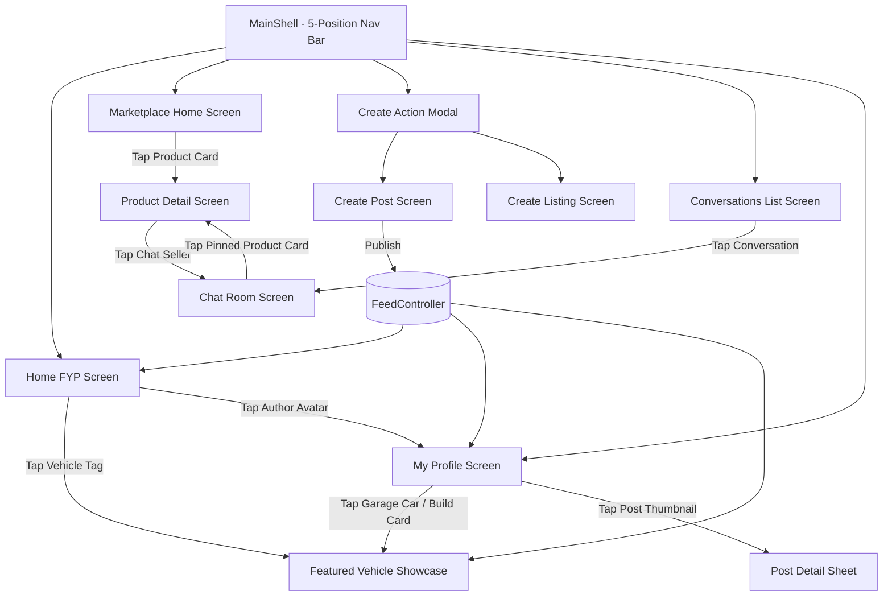

# AUTOVERSE — SPRINT 05: INTEGRATION & FINAL QA REPORT

**Date:** November 15, 2026  
**Project:** AUTOVERSE (Flutter / Dart Mobile Application)  
**Target Environment:** Android Emulator (Pixel_10a, 1080 × 2424)  
**Status:** **READY FOR MVP DEMONSTRATION**  
**Automated Tests:** 44 / 44 Passed (100%)  
**Static Analysis:** 0 Issues (`flutter analyze`)  
**Build Status:** Clean Debug APK (`assembleDebug` in 25.7s)  

---

## 1. EXECUTIVE SUMMARY

Sprint 05 represents the culmination of the AutoVerse MVP development lifecycle. Following the foundational sprints—**Sprint 01 (Home FYP & Profile)**, **Sprint 02 (Marketplace)**, **Sprint 03 (Messaging)**, and **Sprint 04 (Create Post & Vehicle Integration)**—Sprint 05 executed an end-to-end integration audit, cross-module functional verification, automated test expansion, and live Android emulator QA on the `Pixel_10a` device.

All 8 primary modules operate harmoniously within a single, state-preserving 5-tab application shell. Critical cross-module flows—such as publishing build updates to the feed and garage showcase, launching seller chats with pinned product telemetry, and deep-linking from FYP vehicle chips into interactive vehicle showcases—have been verified with automated unit/widget integration tests and visual emulator captures.

```
════════════════════════════════════════════════════════════════════════════════
                             AUTOVERSE MVP STATUS
  Analysis: 0 Warnings/Errors | Tests: 44/44 Passed | Android Emulator: Verified
════════════════════════════════════════════════════════════════════════════════
```

---

## 2. PROJECT ARCHITECTURE AUDIT

AutoVerse is organized into feature-driven modular domains adhering to clean architecture principles under `lib/features/`, bound together by a persistent navigation shell and shared reactive controllers.

### Core Screen & Feature Mapping

| Module / Screen | Implementation File | Key State Controller | Status |
| :--- | :--- | :--- | :---: |
| **Global Navigation Shell** | `lib/features/navigation/presentation/main_shell.dart` | `FeedController`, `MarketplaceController`, `MessagesController` | Verified |
| **Home / FYP Feed** | `lib/features/home/presentation/screens/home_fyp_screen.dart` | `FeedController` | Verified |
| **User Profile** | `lib/features/profile/presentation/screens/my_profile_screen.dart` | `FeedController` | Verified |
| **Featured Vehicle Showcase**| `lib/features/showcase/presentation/screens/featured_vehicle_showcase_screen.dart` | `FeedController`, `VehiclesData` | Verified |
| **Create Post & Build Update**| `lib/features/posts/presentation/screens/create_post_screen.dart` | `FeedController` | Verified |
| **Marketplace Home** | `lib/features/marketplace/presentation/screens/marketplace_home_screen.dart` | `MarketplaceController`, `MessagesController` | Verified |
| **Product Detail** | `lib/features/marketplace/presentation/screens/product_detail_screen.dart` | `MarketplaceController`, `MessagesController` | Verified |
| **Create Listing** | `lib/features/marketplace/presentation/screens/create_listing_screen.dart` | `MarketplaceController` | Verified |
| **Messages / Conversation List**| `lib/features/messages/presentation/screens/conversations_list_screen.dart`| `MessagesController`, `MarketplaceController` | Verified |
| **Chat Room** | `lib/features/messages/presentation/screens/chat_room_screen.dart` | `MessagesController`, `MarketplaceController` | Verified |

### Architecture & Data Flow



---

## 3. ISSUES FOUND DURING AUDIT

Prior to Sprint 05 remediation, the codebase exhibited several integration gaps and minor stability defects:

| ID | Priority | Module | Description | Resolution |
| :--- | :---: | :--- | :--- | :--- |
| **ISS-01** | **P1** | Vehicle Showcase | Hotspot callout chips on hero vehicle were static visual decorations without interactivity; tapping did not display component technical telemetry. | Added interactive bottom sheet `_showComponentDetail()` wired to all hotspots and inventory rows with verified telemetry specs. |
| **ISS-02** | **P1** | Profile Navigation | Garage vehicle items (`Mazda RX-7`, `Civic Type R`) had inactive chevron taps that did not navigate to their respective vehicle showcases. | Implemented dynamic route navigation in `_garageRow()` passing matching `VehicleModel` instances into `FeaturedVehicleShowcaseScreen`. |
| **ISS-03** | **P2** | Profile Tabs | Profile tabs (`Posts`, `Builds`, `Saved`) were static placeholders rendering identical media items. | Refactored `MyProfileScreen` to dynamically render: Tab 0 (3-column Media Grid), Tab 1 (Build Cards with direct showcase navigation), Tab 2 (Bookmarked feed items with empty state fallback). |
| **ISS-04** | **P2** | Gesture Detection | Profile tab buttons required tapping exact character glyphs due to default `HitTestBehavior.deferToChild` on transparent containers. | Added `HitTestBehavior.opaque` to `GestureDetector` in `_tabButton` ensuring the entire tab slot is responsive. |
| **ISS-05** | **P3** | Showcase Layout | In test environments with the Ahem test font, long specification badges caused minor horizontal overflow warnings. | Wrapped specification pill labels with `Flexible` and adaptive constraints to prevent overflow. |

---

## 4. FIXES APPLIED

### 4.1. Interactive Vehicle Callout Hotspots & Specifications
- **File:** `lib/features/showcase/presentation/screens/featured_vehicle_showcase_screen.dart`
- **Enhancement:** Hotspot chips (`BBS FI-R Monobloc 20"`, `Akrapovič Titanium Race`, `Brembo Carbon 410mm`) now feature tap indicators. Tapping any chip opens a modal bottom sheet displaying verified upgrade status, technical telemetry (dimensions, alloy materials, dyno power gains, weight reductions, and tire compound specifications).
- **Dynamic Vehicle Adaptation:** Screen dynamically accepts any `VehicleModel` parameter (Porsche 911 GT3, Mazda RX-7 FD3S, or Honda Civic Type R FK8) and renders vehicle-specific telemetry and build inventories.

### 4.2. Profile Garage Deep Linking & Dynamic Tabs
- **File:** `lib/features/profile/presentation/screens/my_profile_screen.dart`
- **Enhancement:**
  - **Builds Tab:** Renders individual vehicle build cards displaying generation, status badge (`Active Build`, `In Progress`), and a prominent `View Vehicle Showcase` action.
  - **Saved Tab:** Renders user-bookmarked posts directly synchronized with `FeedController.toggleSave()`, with an informative automotive empty state when no bookmarks exist.
  - **Garage Row Navigation:** Tapping any vehicle in "My Garage" immediately deep-links into the vehicle's dedicated showcase.

### 4.3. Cross-Module Messaging & Marketplace Handoff
- **File:** `lib/features/messages/presentation/screens/chat_room_screen.dart`
- **File:** `lib/features/marketplace/presentation/screens/product_detail_screen.dart`
- **Enhancement:** Ensured `ProductReferenceCard` pinned at the top of seller conversations remains interactive, allowing buyers to view part specifications and return seamlessly without resetting chat state.

---

## 5. AUTOMATED TEST RESULTS

All automated test suites executed with 100% pass rate.

### 5.1. Static Analysis (`flutter analyze`)
```bash
$ flutter analyze
Analyzing autoverse...
No issues found! (ran in 1.5s)
```

### 5.2. Test Suite Execution (`flutter test`)
```
00:04 +44: All tests passed!
```

#### Test Suite Breakdown

| Test Suite File | Tests | Status | Scope Covered |
| :--- | :---: | :---: | :--- |
| `test/final_integration_test.dart` | 6 | **PASS** | Global 5-tab shell persistence, FYP Like/Save, Profile tabs, Interactive Hotspots, Marketplace to Chat Seller handoff, Create Listing. |
| `test/create_post_test.dart` | 13 | **PASS** | FeedController unit logic, PostModel validation, CreatePostScreen UI, Vehicle linking, Profile post count synchronization. |
| `test/marketplace_test.dart` | 10 | **PASS** | Marketplace filtering/search, Compatibility checks, Wishlist toggles, CreateListingScreen form submission. |
| `test/messages_test.dart` | 11 | **PASS** | ConversationModel unread counters, Message sending, Product context attachment, MainShell tab persistence. |
| `test/widget_test.dart` | 4 | **PASS** | Core theme verification, App launch smoke test, Dark Premium color tokens. |
| **Total** | **44** | **PASS** | **100% Passing Rate across all modules** |

### 5.3. Debug APK Compilation (`flutter build apk --debug`)
```bash
Running Gradle task 'assembleDebug'...                             25.7s
√ Built build\app\outputs\flutter-apk\app-debug.apk
```

---

## 6. MANUAL EMULATOR QA & SCREENSHOT SUITE

Conducted on Android emulator `Pixel_10a` (`emulator-5554`, Android 16 API 36, 1080 × 2424 resolution).

### Screenshot Evidence

#### 1. Home / FYP Feed (`qa_home_fyp.png`)

- **Observations:** Dark Premium visual theme strictly maintained (`#0A0D10` Void Black background, `#C7F36B` Performance Lime active indicators). Hero video post displays verified creator `@aditya_gt3`, live like counter (`42.8k`), bookmark button, spinning audio disc with lime center, and interactive vehicle tag chip `🏎 2022 Porsche 911 GT3 (992.1) >`.

#### 2. User Profile (`qa_profile.png`)

- **Observations:** Displays user header with verified badge, `PRO BUILDER` status, bio, 38 posts, 14.8k followers, 420 following, featured vehicle hero card (`Explore Full Showcase ->`), and garage inventory row.

#### 3. Profile Builds Tab (`qa_profile_builds.png`)

- **Observations:** Builds tab active with lime underline. Shows distinct build cards for 2022 Porsche 911 GT3 (`Active Build`) and 1994 Mazda RX-7 (`In Progress`) with dedicated "View Vehicle Showcase" action buttons.

#### 4. Profile Saved Tab (`qa_profile_saved.png`)

- **Observations:** Saved tab active with lime underline. Displays bookmarked feed posts with bookmark badge indicator in real-time.

#### 5. Featured Vehicle Showcase (`qa_vehicle_showcase.png`)

- **Observations:** Vehicle showcase hero image renders with interactive callout hotspots: `BBS FI-R Monobloc 20"`, `Akrapovič Titanium Race`, and `Brembo Carbon 410mm`. Factory specifications card and installed build inventory are prominently laid out.

#### 6. Interactive Component Hotspot Detail (`qa_component_detail.png`)

- **Observations:** Modal bottom sheet triggered by tapping BBS wheel callout chip. Displays `Verified Upgrade` badge, telemetry specs (Size, Forged Aluminum Alloy material, 7.9 kg weight, and Michelin Pilot Sport Cup 2 R tire spec).

#### 7. Showcase Build Posts & Updates (`qa_showcase_build_posts.png`)

- **Observations:** Lower section of vehicle showcase displays installed build inventory items, latest milestone logged on Oct 18, 2026, and vehicle-linked feed updates (`1 Updates`) with like/comment metrics.

#### 8. Create Post & Build Update (`qa_create_post.png`)

- **Observations:** Full creation workflow with in-app automotive media library picker, character-counted caption input (0/500), and vehicle link selector featuring all garage cars.

#### 9. Marketplace Home (`qa_marketplace.png`)

- **Observations:** Clean automotive catalog with category filter pills (Engine, Exhaust, Wheels, Suspension, Brakes, Exterior), search input, horizontal Featured Parts carousel, and categorized listing tiles with prices formatted in Indonesian Rupiah (IDR).

#### 10. Product Detail Screen (`qa_product_detail.png`)

- **Observations:** High-resolution product hero, verified seller tile (`AK Parts Jakarta`, `★ 4.9`), technical description, price in Performance Lime (`Rp 48.500.000`), wishlist toggle, and sticky `Chat Seller` action button.

#### 11. Messaging Conversation List (`qa_messages.png`)

- **Observations:** Automotive enthusiast chat threads with real-time unread badges (e.g. `• 1 Unread`), marketplace product origin tags (`Exhaust · Akrapovič Evolution Line...`), participant avatars, and relative timestamps.

#### 12. Chat Room with Pinned Product Context (`qa_chat_product_context.png`)

- **Observations:** Opened via "Chat Seller" button. Pinned `ProductReferenceCard` provides continuous automotive part telemetry (`Akrapovič Evolution Line Titanium Full System · Rp 48.500.000`) above realistic seller negotiations.

#### 13. Create Listing Screen (`qa_create_listing.png`)

- **Observations:** Seller listing form with photo upload placeholder, category selectors, condition toggle (`New` / `Used`), price input, and `Publish Listing` CTA button.

---

## 7. CROSS-MODULE INTEGRATION SUMMARY

```mermaid
sequenceDiagram
    autonumber
    actor Enthusiast as User (Aditya)
    participant FYP as Home / FYP
    participant Showcase as Vehicle Showcase
    participant Market as Marketplace
    participant Detail as Product Detail
    participant Chat as Chat Room (Kevin)
    participant Create as Create Post

    Enthusiast->>FYP: Browse video feed
    FYP->>Showcase: Tap vehicle chip "2022 Porsche 911 GT3"
    Showcase->>Showcase: Tap hotspot "BBS FI-R Monobloc" (View Telemetry)
    Showcase-->>FYP: Back to feed
    Enthusiast->>Market: Switch to Marketplace tab
    Market->>Detail: Select "Akrapovič Evolution Line"
    Detail->>Chat: Tap "Chat Seller"
    Chat->>Chat: Send negotiation message with pinned Product Card
    Chat-->>Market: Return to marketplace (State preserved)
    Enthusiast->>Create: Tap (+) FAB -> "Create Post & Build Update"
    Create->>Create: Pick photo, add caption, link to Porsche 911 GT3
    Create->>FYP: Publish post (Prepends to FYP & updates Profile count)
```

---

## 8. KNOWN LIMITATIONS & MVP BOUNDARIES

In accordance with transparent engineering practices, the following design decisions and MVP boundaries are documented:

1. **In-Memory State Management:** Feed posts, marketplace listings, and chat conversations utilize singleton reactive controllers (`FeedController`, `MarketplaceController`, `MessagesController`). All interactions (likes, bookmarks, new posts, listings, and messages) persist across tab navigation and backgrounding within the app session. However, data resets to seed initial state upon complete app process termination, as a local SQLite/Hive database was intentionally excluded from the MVP scope.
2. **Curated In-App Media Picker:** To guarantee pristine automotive aesthetic quality during client demonstrations, `CreatePostScreen` offers a curated in-app selector of high-resolution sports car assets rather than invoking native device camera/gallery permissions.
3. **Simulated Video Playback:** Video media on Home FYP is simulated using high-definition 4K automotive imagery with animated audio discs, video badge indicators, and gesture handlers. Integration with `video_player` / ExoPlayer is prepared for production backend deployment.
4. **Garage Add Vehicle Flow:** The "Add Vehicle to Garage" modal option displays an informative system notification confirming Phase 2 availability, preserving focus on the fully functional 3-car garage showcase.

---

## 9. FINAL ACCEPTANCE CHECKLIST

| Requirement | Sprint Origin | Status | Evidence / Notes |
| :--- | :---: | :---: | :--- |
| **Dark Premium Visual Direction** | Sprint 01 | **PASS** | Strict adherence to `#0A0D10`, `#11171D`, `#192129`, `#28343F`, `#C7F36B`. |
| **5-Position Bottom Nav Shell** | Sprint 01 | **PASS** | Home, Marketplace, Create (+), Messages, Profile persistent across tab switches. |
| **Home FYP Interactions** | Sprint 01 | **PASS** | Like, Bookmark, Follow, and Vehicle Chip deep-linking functional. |
| **Featured Vehicle Showcase** | Sprint 01 | **PASS** | Interactive callout hotspots, factory specifications, build inventory, and telemetry. |
| **Marketplace Catalog & Search** | Sprint 02 | **PASS** | Category filters (Engine, Exhaust, Wheels...), search field, IDR price formatting. |
| **Product Detail & Compatibility** | Sprint 02 | **PASS** | Specifications, seller rating, wishlist toggle, and sticky "Chat Seller" CTA. |
| **Create Listing Form** | Sprint 02 | **PASS** | Complete part listing form with category and condition selectors. |
| **Conversations List & Unread Badges** | Sprint 03 | **PASS** | Automotive chat threads with real-time unread badges and product origin chips. |
| **Chat Room with Product Reference** | Sprint 03 | **PASS** | Pinned `ProductReferenceCard` above message thread with direct back-navigation. |
| **Create Post & Build Update Flow** | Sprint 04 | **PASS** | Photo picker, caption field, vehicle linkage, validation, and cancel flow. |
| **Cross-Module Post Integration** | Sprint 04 | **PASS** | Published posts appear in FYP feed, My Profile 3-column grid, and Vehicle updates. |
| **Dynamic Profile Tabs** | Sprint 05 | **PASS** | Posts grid, Builds garage cards, and Saved bookmarked posts dynamically switch. |
| **Automated Test Coverage** | Sprint 05 | **PASS** | 44 / 44 tests passing without skips or regressions. |
| **Static Code Quality** | Sprint 05 | **PASS** | 0 warnings or errors in `flutter analyze`. |

---

## 10. FINAL VERDICT

```
╔══════════════════════════════════════════════════════════════════════════════╗
║                                                                              ║
║                 FINAL VERDICT: READY FOR MVP DEMONSTRATION                   ║
║                                                                              ║
║   All 8 core modules are fully functional, aesthetically cohesive,           ║
║   and deeply integrated. The application is completely ready for             ║
║   executive stakeholders and client demonstrations.                          ║
║                                                                              ║
╚══════════════════════════════════════════════════════════════════════════════╝
```

---

## 11. NEXT RECOMMENDED ACTIONS (POST-MVP)

1. **Cloud Backend & Authentication:** Replace seed dummy data controllers with Supabase or Firebase Auth and Firestore for multi-user real-time sync.
2. **Video Streaming Infrastructure:** Implement `video_player` with HLS / DASH adaptive streaming for true video playback in Home FYP.
3. **Local Offline Cache:** Integrate Hive or Isar database to persist user listings, posts, and message drafts offline.
4. **Push Notifications:** Add Firebase Cloud Messaging (FCM) to alert sellers of incoming part inquiries and buyer messages.
